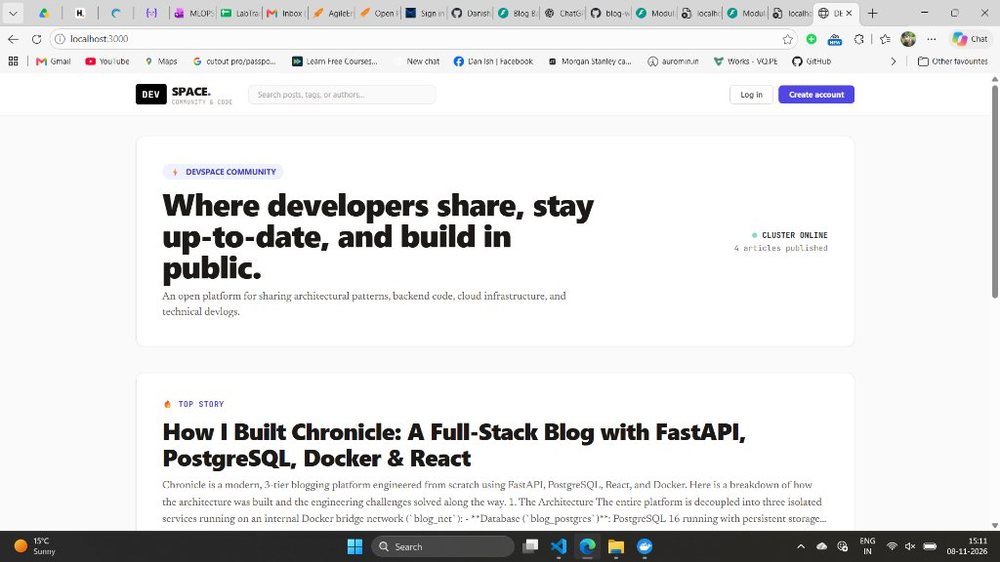
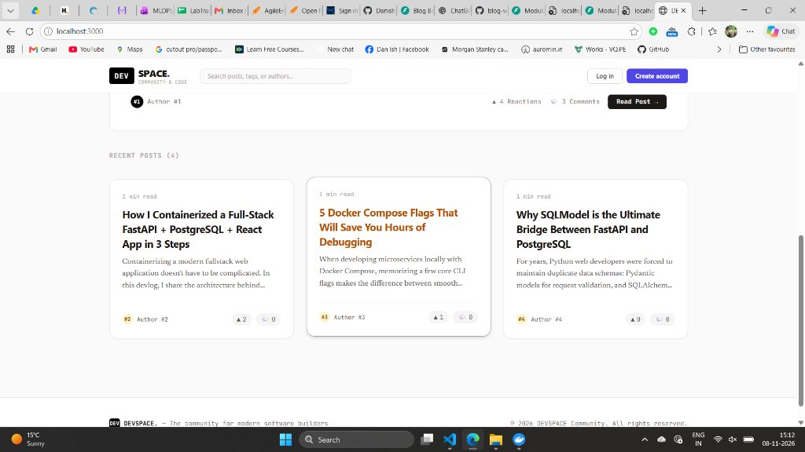
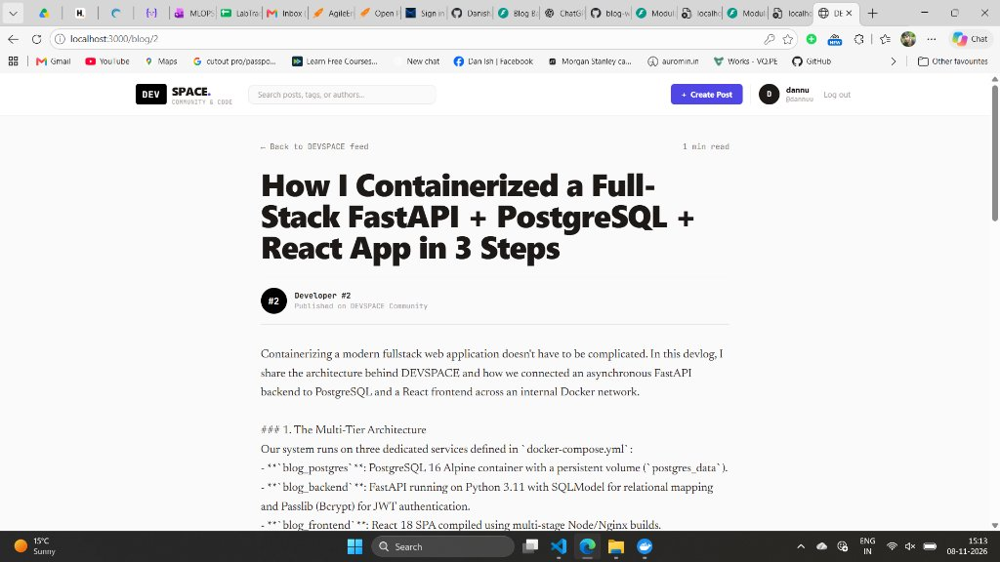

# Lab 82: Production 3-Tier Web Architecture, Container Orchestration & Docker Compose Deployment


> [!NOTE]
> This file corresponds to **Task 82 (`82-README.md`)** in the LabTracker curriculum sheet.
> Full comprehensive architectural deployment documentation is maintained at [82-blog-web-app-3-tier-deploy.md](file:///C:/Users/danis/Desktop/blog-web-app/82-blog-web-app-3-tier-deploy.md).

---

## 📌 1. Executive Summary & Architectural Overview

Modern cloud-native web engineering demands decoupled, resilient, and reproducible deployment patterns. The classic monolithic approach—where HTML templates, business logic, and embedded database files run within a single operating system process—fails under high traffic, creates deployment bottlenecks, and introduces severe security risks.

This lab delivers a **production-grade, 3-tier containerized platform** named **DEVSPACE**. The system separates concerns across three dedicated, isolated micro-containers running on a private Docker bridge network:

```text
┌─────────────────────────────────────────────────────────────────────────────────────────────────┐
│                           DEVSPACE 3-Tier Enterprise Web Architecture                           │
└─────────────────────────────────────────────────────────────────────────────────────────────────┘

                              [ User Web Browser ]
                                       │
                    ┌──────────────────┴──────────────────┐
     HTTP:3000      │                                     │      HTTP:8000
 (Client Traffic)   │                                     │  (API & Swagger Docs)
                    ▼                                     ▼
        ┌───────────────────────┐             ┌───────────────────────┐
        │     TIER 1: WEB       │             │     TIER 2: APP       │
        │     blog_frontend     │             │     blog_backend      │
        │  React 18 + Vite SPA  │             │   FastAPI ASGI App    │
        │  Alpine Nginx Proxy   │────────────►│  Uvicorn (Python 3.11)│
        │  [Port 3000 -> 80]    │   REST /    │  [Port 8000 -> 8000]  │
        └───────────────────────┘   JSON      └───────────┬───────────┘
                    │                                     │
                    │        blog_net (Docker Bridge)     │
                    └──────────────────┬──────────────────┘
                                       │
                                       ▼ TCP:5432
                            ┌─────────────────────┐
                            │    TIER 3: DATA     │
                            │    blog_postgres    │
                            │   PostgreSQL 16     │
                            │  [Port 5432 -> 5432]│
                            │                     │
                            │  [postgres_data]    │ (Persistent Named Volume)
                            └─────────────────────┘
```

---

## 🚀 Quick Deployment Guide

### 1. Launch All Services
```bash
docker compose up --build -d
```

### 2. Live Services
* **Frontend Web Application**: [http://localhost:3000](http://localhost:3000)
* **Backend Swagger API Docs**: [http://localhost:8000/docs](http://localhost:8000/docs)
* **PostgreSQL Database**: `localhost:5432`

---

## 📸 Application Showcase

| 🌟 **Developer Community Feed & Hero Banner** |
|:---:|
|  |

| 📰 **Interactive Articles Grid** | 📖 **Full Article Reader & Authenticated Writer** |
|:---:|:---:|
|  |  |

---

## 📁 Repository Map
* `backend/` — FastAPI microservice with modular routers, SQLModel, JWT & Bcrypt.
* `frontend/` — React 18, Vite, TypeScript, Tailwind CSS, Alpine Nginx.
* `db/init.sql` — PostgreSQL DDL schema migrations.
* `docker-compose.yml` — Container orchestration definition with healthchecks.
* `82-blog-web-app-3-tier-deploy.md` — Complete master deployment documentation.
