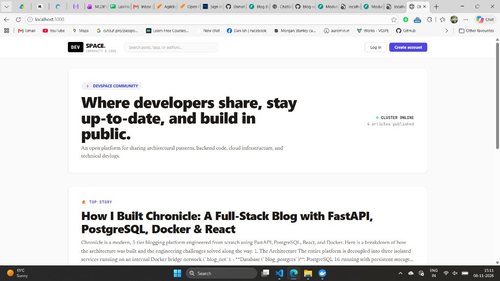
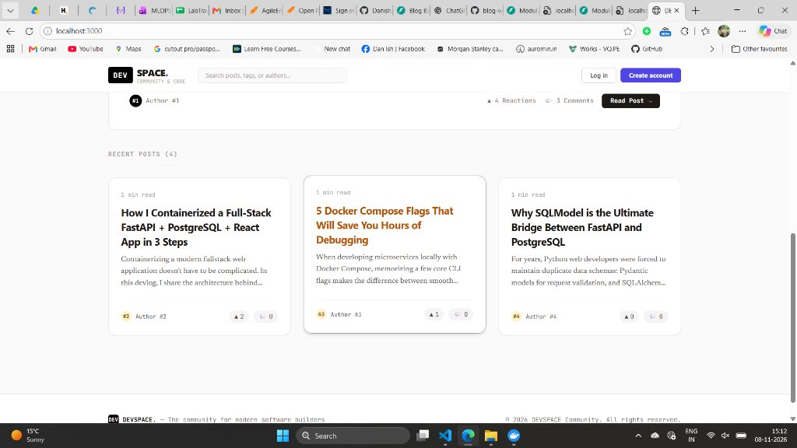
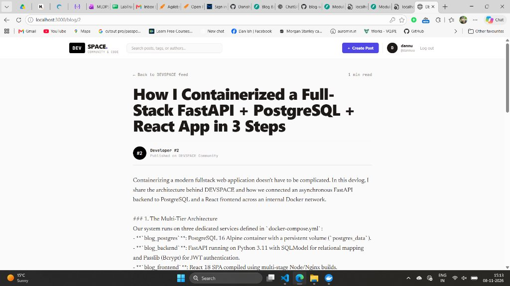

# Lab 82: Production 3-Tier Web Architecture, Container Orchestration & Docker Compose Deployment


---

## 📌 1. Executive Summary & Architectural Overview

Modern cloud-native web engineering demands decoupled, resilient, and reproducible deployment patterns. The classic monolithic approach—where HTML templates, business logic, and embedded database files run within a single operating system process—fails under high traffic, creates deployment bottlenecks, and introduces severe security risks.

This lab delivers a **production-grade, 3-tier containerized platform** named **DEVSPACE**. The system separates concerns across three dedicated, isolated micro-containers running on a private Docker bridge network:

```text
┌─────────────────────────────────────────────────────────────────────────────────────────────────┐
│                           DEVSPACE 3-Tier Enterprise Web Architecture                           │
└─────────────────────────────────────────────────────────────────────────────────────────────────┘

                              [ User Web Browser ]
                                       │
                    ┌──────────────────┴──────────────────┐
     HTTP:3000      │                                     │      HTTP:8000
 (Client Traffic)   │                                     │  (API & Swagger Docs)
                    ▼                                     ▼
        ┌───────────────────────┐             ┌───────────────────────┐
        │     TIER 1: WEB       │             │     TIER 2: APP       │
        │     blog_frontend     │             │     blog_backend      │
        │  React 18 + Vite SPA  │             │   FastAPI ASGI App    │
        │  Alpine Nginx Proxy   │────────────►│  Uvicorn (Python 3.11)│
        │  [Port 3000 -> 80]    │   REST /    │  [Port 8000 -> 8000]  │
        └───────────────────────┘   JSON      └───────────┬───────────┘
                    │                                     │
                    │        blog_net (Docker Bridge)     │
                    └──────────────────┬──────────────────┘
                                       │
                                       ▼ TCP:5432
                            ┌─────────────────────┐
                            │    TIER 3: DATA     │
                            │    blog_postgres    │
                            │   PostgreSQL 16     │
                            │  [Port 5432 -> 5432]│
                            │                     │
                            │  [postgres_data]    │ (Persistent Named Volume)
                            └─────────────────────┘
```

### Architectural Highlights:
1. **Tier 1 — Presentation (Frontend)**: React 18, TypeScript, Tailwind CSS, Vite. Packaged via multi-stage Docker build and served by a high-performance **Nginx Alpine** web server with SPA history fallback.
2. **Tier 2 — Business Logic (Backend)**: **FastAPI (Python 3.11 ASGI)**. Implements modular route controllers (`/auth`, `/users`, `/blogs`), SQLModel ORM, stateless OAuth2 JWT authentication, and salted Bcrypt password hashing.
3. **Tier 3 — Persistence (Database)**: **PostgreSQL 16**. Enforces relational integrity, cascading foreign keys, automated initialization DDL scripts (`init.sql`), and persistent storage surviving container lifecycles.
4. **Orchestration**: **Docker Compose v2**. Manages service discovery, deterministic startup ordering with healthchecks (`pg_isready`), and environment isolation.

---

## 🏛️ 2. Detailed Tier-by-Tier Breakdown

### 2.1 Tier 1: Presentation (React + Vite + Nginx)
* **Framework**: React 18 with TypeScript for type-safe UI components.
* **Styling**: Tailwind CSS delivering a modern developer-focused UI (inspired by DEV.to).
* **State & Authentication**: Global `AuthContext` maintaining token lifecycle and auto-attaching Bearer tokens to all outgoing Axios requests.
* **Multi-Stage Docker Strategy**:
  * **Stage 1 (Builder)**: Node 20 Alpine installs dependencies, verifies types, and compiles static assets to `/app/dist`.
  * **Stage 2 (Runtime)**: Clean Nginx Alpine image copies only compiled static assets, resulting in a microscopic production image (~25MB) with zero Node.js runtime attack surface.
* **SPA Routing Fallback**: Configured with `try_files $uri $uri/ /index.html =404;` in `nginx.conf` so client-side routes (`/post/:id`, `/user/:id`) never return HTTP 404 on hard refresh.

### 2.2 Tier 2: Application (FastAPI Microservice)
* **Modular Router Pattern**:
  * `routes/auth.py`: Handles `/login` and `/token` via `OAuth2PasswordRequestForm`.
  * `routes/users.py`: Handles registration (`POST /user`), profile retrieval (`GET /user/me`), and user following (`POST /user/{id}/follow`).
  * `routes/blogs.py`: Handles article publishing, deletion with author verification, commenting, and optimistic like toggling.
* **Security Subsystem**:
  * **Bcrypt**: 12 expansion rounds ($2^{12} = 4,096$ iterations) via Passlib.
  * **JWT**: Signed with HMAC-SHA256 (`HS256`), carrying standard `sub` and `exp` claims.
  * **Zero-Trust Ownership**: Strict author verification prevents unauthorized deletion of articles by other users (`403 Forbidden`).
* **Cross-Origin Resource Sharing (CORS)**: `CORSMiddleware` configured to securely permit communication from `http://localhost:3000`.

### 2.3 Tier 3: Database (PostgreSQL 16)
* **Relational Schema**:
  * `user`: Primary user entities (`id`, `username`, `email`, `hashed_password`, `bio`).
  * `blog`: Published posts with `author_id` referencing `user.id` on delete cascade.
  * `comment`: Threaded responses referencing both `blog.id` and `user.id`.
  * `like_tracker`: Composite primary key `(liker_id, blog_id)` preventing duplicate endorsements.
  * `user_follow`: Composite primary key `(follower_id, followed_id)` modeling user relationships.
* **Automated Migration**: PostgreSQL executes `/docker-entrypoint-initdb.d/init.sql` upon first volume initialization to build tables, constraints, and indexes automatically.

---

## 🐳 3. Containerization & Orchestration Specifications

### 3.1 Frontend Dockerfile (`frontend/Dockerfile`)
```dockerfile
# ------------------------------------------------------------------------------
# STAGE 1: Build the production static distribution
# ------------------------------------------------------------------------------
FROM node:20-alpine AS builder
WORKDIR /app

COPY package*.json ./
RUN npm ci

COPY . .
RUN npm run build

# ------------------------------------------------------------------------------
# STAGE 2: High-Performance Nginx Alpine Runtime
# ------------------------------------------------------------------------------
FROM nginx:alpine

# Copy custom Nginx configuration with SPA fallback
COPY nginx.conf /etc/nginx/conf.d/default.conf

# Copy compiled static assets from builder stage
COPY --from=builder /app/dist /usr/share/nginx/html

EXPOSE 80
CMD ["nginx", "-g", "daemon off;"]
```

### 3.2 Frontend Nginx Configuration (`frontend/nginx.conf`)
```nginx
server {
    listen 80;
    server_name localhost;

    location / {
        root /usr/share/nginx/html;
        index index.html index.htm;
        # Essential for Single Page Applications (React Router)
        try_files $uri $uri/ /index.html;
    }

    error_page 500 502 503 504 /50x.html;
    location = /50x.html {
        root /usr/share/nginx/html;
    }
}
```

### 3.3 Backend Dockerfile (`backend/Dockerfile`)
```dockerfile
FROM python:3.11-slim

WORKDIR /app

# Prevent Python from writing .pyc files and enable unbuffered output
ENV PYTHONDONTWRITEBYTECODE=1
ENV PYTHONUNBUFFERED=1

# Install runtime dependencies
COPY requirements.txt .
RUN pip install --no-cache-dir -r requirements.txt

# Copy application source code
COPY . .

EXPOSE 8000

# Start Uvicorn ASGI server
CMD ["uvicorn", "main:app", "--host", "0.0.0.0", "--port", "8000"]
```

### 3.4 Orchestration: `docker-compose.yml`
```yaml
version: '3.8'

services:
  # ============================================================================
  # TIER 3: PostgreSQL Database
  # ============================================================================
  db:
    image: postgres:16-alpine
    container_name: blog_postgres
    restart: unless-stopped
    environment:
      POSTGRES_USER: ${POSTGRES_USER:-postgres}
      POSTGRES_PASSWORD: ${POSTGRES_PASSWORD:-postgres}
      POSTGRES_DB: ${POSTGRES_DB:-blog_db}
    ports:
      - "5432:5432"
    volumes:
      - postgres_data:/var/lib/postgresql/data
      - ./db/init.sql:/docker-entrypoint-initdb.d/init.sql:ro
    healthcheck:
      test: ["CMD-SHELL", "pg_isready -U ${POSTGRES_USER:-postgres} -d ${POSTGRES_DB:-blog_db}"]
      interval: 5s
      timeout: 5s
      retries: 5
    networks:
      - blog_net

  # ============================================================================
  # TIER 2: FastAPI Application Server
  # ============================================================================
  backend:
    build:
      context: ./backend
      dockerfile: Dockerfile
    container_name: blog_backend
    restart: unless-stopped
    environment:
      DATABASE_URL: postgresql://${POSTGRES_USER:-postgres}:${POSTGRES_PASSWORD:-postgres}@db:5432/${POSTGRES_DB:-blog_db}
      SECRET_KEY: ${SECRET_KEY:-blogsecret@123}
      ALGORITHM: HS256
      ACCESS_TOKEN_EXPIRE_MINUTES: 60
    ports:
      - "8000:8000"
    depends_on:
      db:
        condition: service_healthy
    networks:
      - blog_net

  # ============================================================================
  # TIER 1: React 18 + Nginx Frontend
  # ============================================================================
  frontend:
    build:
      context: ./frontend
      dockerfile: Dockerfile
    container_name: blog_frontend
    restart: unless-stopped
    ports:
      - "3000:80"
    depends_on:
      - backend
    networks:
      - blog_net

# ==============================================================================
# NETWORKS & VOLUMES
# ==============================================================================
networks:
  blog_net:
    driver: bridge

volumes:
  postgres_data:
    driver: local
```

---

## 🚀 4. Step-by-Step Deployment Runbook

Follow these exact steps to spin up, test, and manage the full 3-tier architecture.

### Step 1: Clone Repository & Enter Directory
```powershell
git clone https://github.com/Danish20699/blog-web-app.git
cd blog-web-app
```

### Step 2: Initialize Environment File
Copy the provided `.env.example` into `.env`:
```powershell
Copy-Item .env.example .env
```

### Step 3: Single-Command Fullstack Build & Launch
Build all container images and start the services in detached mode:
```powershell
docker compose up --build -d
```

### Step 4: Verify Container Health & Status
Check that all three containers are in the `Up` state and `healthy`:
```powershell
docker compose ps
```
*Expected Output:*
```text
NAME            IMAGE                      COMMAND                  SERVICE    STATUS
blog_postgres   postgres:16-alpine         "docker-entrypoint.s…"   db         Up (healthy)
blog_backend    blog-web-app-backend       "uvicorn main:app --…"   backend    Up
blog_frontend   blog-web-app-frontend      "/docker-entrypoint.…"   frontend   Up
```

### Step 5: Verify Live Endpoints
Open your browser to verify all active tiers:
* 🌐 **Frontend Application**: [http://localhost:3000](http://localhost:3000)
* 📖 **Backend Swagger UI**: [http://localhost:8000/docs](http://localhost:8000/docs)
* 📑 **Backend ReDoc**: [http://localhost:8000/redoc](http://localhost:8000/redoc)

---

## 🧪 5. Verification & Smoke Testing Guide

### 5.1 Test Registration (`POST /user`)
Register the initial author account:
```powershell
curl -X POST "http://localhost:8000/user" `
  -H "Content-Type: application/json" `
  -d '{"name": "Danish Nazir", "username": "danish", "password": "Password123!", "email": "danish@devspace.io", "bio": "Lead Architect"}'
```
*Response: HTTP 201 Created*

### 5.2 Test Login & Acquire JWT (`POST /login`)
Authenticate using form-data:
```powershell
curl -X POST "http://localhost:8000/login" `
  -d "username=danish&password=Password123!"
```
*Response: HTTP 200 OK with Bearer access token.*

### 5.3 Test Publishing a Blog Post (`POST /blog`)
Publish a post using the acquired token:
```powershell
curl -X POST "http://localhost:8000/blog" `
  -H "Authorization: Bearer <YOUR_ACCESS_TOKEN>" `
  -H "Content-Type: application/json" `
  -d '{"title": "Scaling FastAPI with Docker Compose", "content": "Comprehensive runbook covering multi-tier architecture, network isolation, and healthchecks."}'
```
*Response: HTTP 201 Created with auto-bound `author_id`.*

### 5.4 Direct Database Inspection via Docker
Query PostgreSQL inside the container to verify persistent data storage:
```powershell
docker compose exec db psql -U postgres -d blog_db -c "SELECT id, title, author_id FROM blog;"
```

### 5.5 Visual Verification & Production Screenshots

The 3-tier containerized stack was verified locally across presentation, business logic, and database layers:

#### Presentation Tier: React 18 + Tailwind CSS on Nginx Alpine (Port 3000)
| 🌟 **Developer Community Hero & Top Story** |
|:---:|
|  |

| 📰 **Recent Articles Feed** | 📖 **Authenticated Reader & Writer View** |
|:---:|:---:|
|  |  |

---

## 🛠️ 6. Operational & Management Commands

| Operation | Command | Purpose |
|---|---|---|
| **View Live Logs** | `docker compose logs -f` | Tail combined logs across all 3 containers |
| **Backend Logs Only** | `docker compose logs -f backend` | Tail FastAPI application logs and error traces |
| **Stop All Containers** | `docker compose stop` | Pause services without removing containers |
| **Start Containers** | `docker compose start` | Resume paused services |
| **Tear Down** | `docker compose down` | Stop and remove containers and networks |
| **Purge With Data** | `docker compose down -v` | Complete reset (destroys persistent DB volume) |
| **Rebuild Single Tier** | `docker compose up --build -d frontend` | Recompile and redeploy only frontend after code changes |

---

## 🛡️ 7. Production Readiness & Troubleshooting

### Common Issue 1: `pg_isready` Healthcheck Failure
* **Symptom**: Backend container fails to start, showing `dependency failed to start: container blog_postgres is unhealthy`.
* **Fix**: Ensure `POSTGRES_DB` and `POSTGRES_USER` match in both the `db` environment block and the healthcheck command string.

### Common Issue 2: Frontend 404 on Browser Page Reload
* **Symptom**: Refreshing `/post/1` in the browser returns Nginx `404 Not Found`.
* **Fix**: Ensure `frontend/nginx.conf` contains `try_files $uri $uri/ /index.html;`, routing all unmatched requests to React Router.

### Common Issue 3: CORS Block on API Requests
* **Symptom**: Browser console displays `Blocked by CORS policy: No 'Access-Control-Allow-Origin' header is present`.
* **Fix**: Ensure `backend/main.py` specifies `allow_origins=["http://localhost:3000"]` and `allow_credentials=True`.

---

## 🏆 8. Conclusion

By completing Lab 82, you have successfully orchestrated and deployed an enterprise-standard, 3-tier web architecture. The decoupled separation of presentation, business logic, and persistent storage guarantees horizontal scalability, microservice independence, and secure container operations.
